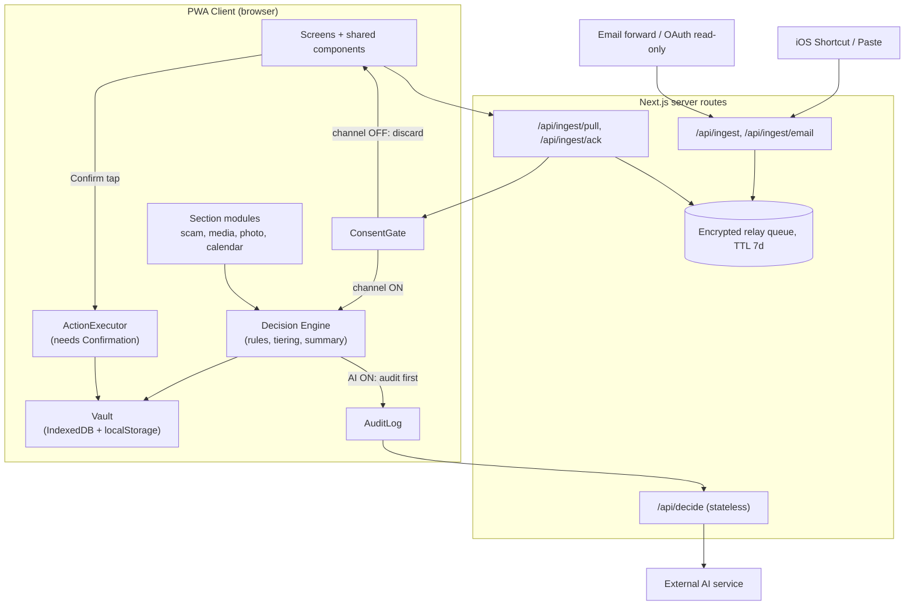
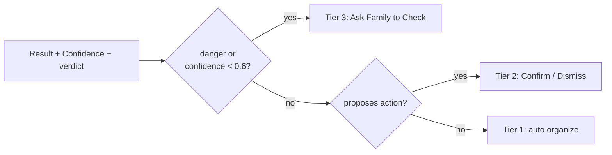

# Design Document

## Overview

The Senior Digital Companion is a local-first, installable Progressive Web App built with Next.js 15 (App Router), TypeScript, and Tailwind CSS v4. It helps older adults stay safe and organized across five sections (Scam Shield, Photo Helper, Unified Inbox, AI Media Check, Calendar), a Home Hub, and a My Data vault.

Three ideas drive the design:

1. **Local-first data.** All Senior data lives in the browser (IndexedDB for items and images, localStorage for small settings). The server holds no Senior data except a short-lived ingest relay (see Decision D3).
2. **Consent as a gate, not a setting.** Every path that stores an item or sends content to AI passes through one `ConsentGate` module. UI code cannot bypass it.
3. **Bounded decisions.** Every AI result is assigned one of three tiers. A single `ActionExecutor` is the only code that performs side effects (save event, share, send, delete), and it runs only when given a `Confirmation` token created by a Confirm tap.

### Key design decisions

| ID | Decision | Rationale | Requirements |
| :-- | :-- | :-- | :-- |
| D1 | Deterministic on-device rules are the baseline engine. AI (`/api/decide`) only refines a result. | AI OFF must work fully with zero network calls. The same code path serves as the fallback on timeout or error. | 5.2, 5.8, 15.9 |
| D2 | Calendar dates and times use `Temporal.PlainDate` / `Temporal.PlainTime` from `temporal-polyfill`, serialized as `YYYY-MM-DD` and `HH:mm`. | Avoids UTC shifts when the device time zone changes. Temporal is not yet in all target browsers, so a polyfill is needed. | 13.5, 13.8, 24.* |
| D3 | Ingest uses an ephemeral per-Senior relay queue. `POST /api/ingest*` validates and enqueues. The client pulls and acknowledges, then applies the ConsentGate and writes to the Local_Store. The relay deletes on ack or after a 7-day TTL. | A local-first PWA has no always-on endpoint, so forwarded items need a place to wait. Relay content is encrypted at rest with a server key. | 10.*, 27.* |
| D4 | The ConsentGate runs on the client at pull time and discards items from OFF channels before any write. | The server does not learn toggle state. Requirement 4.5 requires no write to the Local_Store, which the client enforces. | 4.2 to 4.6 |
| D5 | Property-based tests (fast-check) cover pure logic modules. UI, PWA install, and OAuth wiring use example, snapshot, and smoke tests. | Matches the logic/I-O split in the workflow guidance. | Testing Strategy |
| D6 | Image provenance, OCR, and photo presets run in the browser (EXIF/C2PA parsing library, Tesseract.js, canvas filters). Only the Scam Shield and `/api/decide` text path may call AI, and only with consent. | Keeps photos on the device. | 1.4, 17, 18, 19 |

### Research summary

- Next.js 15 App Router route handlers (`app/api/**/route.ts`) support stateless POST handlers and edge or Node runtimes. Rate limiting and token checks are done in the handler, with `middleware.ts` used only to force HTTPS redirects. Source: [Next.js Route Handlers](https://nextjs.org/docs/app/building-your-application/routing/route-handlers).
- Next.js 15 supports a typed `app/manifest.ts` for the PWA manifest. A hand-written service worker (`public/sw.js`) provides offline shell caching. iOS Safari supports Home Screen web apps with standalone display. Source: [Next.js PWA guide](https://nextjs.org/docs/app/guides/progressive-web-apps).
- `Temporal.PlainDate` has `from`, `toString`, and `compare`, and `from(..., { overflow: 'reject' })` throws on impossible dates such as 2025-02-30. `temporal-polyfill` provides it today. Source: [temporal-polyfill](https://github.com/fullcalendar/temporal-polyfill).
- fast-check provides `fc.assert`, `fc.property`, and `fc.date`/`fc.string` arbitraries with a default of 100 runs, and works under Vitest. Source: [fast-check docs](https://fast-check.dev/).
- C2PA manifests can be read in the browser with the open-source `c2pa` JS SDK, and EXIF with `exifr`. WhatsApp strips most metadata, which is why `Cannot tell` is the honest default. Source: [C2PA JS SDK](https://opensource.contentauthenticity.org/docs/js-sdk/getting-started/overview).

Content was rephrased for compliance with licensing restrictions. Library choices (`c2pa`, `exifr`, Tesseract.js) should be re-verified at implementation time.

## Architecture



### Request flow: forwarded WhatsApp message

```mermaid
sequenceDiagram
    participant S as iOS Shortcut
    participant API as /api/ingest
    participant R as Relay
    participant C as Client
    participant G as ConsentGate
    participant E as Engine
    participant V as Vault
    S->>API: POST (token, source, text)
    API->>API: auth, rate limit, parse
    API->>R: enqueue
    API-->>S: 200
    C->>R: pull (on open / focus)
    C->>G: item(source)
    alt channel OFF
        G-->>C: discard + offer "turn on"
    else channel ON
        G->>E: classify, summarize (rules; AI only if enabled)
        E->>V: write Inbox_Item (Tier 1)
        C->>R: ack (delete)
    end
```

### Decision tier flow



### Project structure

```
src/
  app/
    layout.tsx, manifest.ts, page.tsx            # Home Hub
    my-data/page.tsx                             # Consent_Vault
    scam-shield/  photo-helper/  inbox/  media-check/  calendar/
    api/
      decide/route.ts
      ingest/route.ts
      ingest/email/route.ts
      ingest/pull/route.ts
      ingest/ack/route.ts
  lib/
    vault/        # store.ts, settings.ts, consent.ts, audit.ts, export.ts, import.ts, schema.ts
    ai/           # engine.ts, rules.ts, tiering.ts, proxyClient.ts, summary.ts
    inbox/        # parse.ts, print.ts, classify.ts, dedup.ts, order.ts, events.ts
    calendar/     # dates.ts, ocr.ts, snap.ts, views.ts, reminders.ts, categories.ts
    scam/         # verdict.ts, links.ts, habits.ts
    media/        # provenance.ts, result.ts
    photo/        # presets.ts, filename.ts
    actions/      # executor.ts, confirmation.ts
    errors/       # plainMessage.ts
    server/       # auth.ts, rateLimit.ts, relay.ts
  components/
    SeniorButton.tsx, StepWizard.tsx, TrafficLightCard.tsx,
    SourceBadge.tsx, DecisionConfirmCard.tsx, PriorityPill.tsx,
    StatusLive.tsx, BackToHome.tsx, PrivacyPill.tsx
tests/
  unit/  property/  integration/  a11y/
```

## Components and Interfaces

### Shared UI components (`src/components`)

| Component | Responsibility | Requirements |
| :-- | :-- | :-- |
| `SeniorButton` | Button with min 52x52 px target, 12 px gap, visible text label, optional icon, forced-colors-safe border. | 3.2, 3.6, 3.8 |
| `StepWizard` | Shows one step at a time with a "Step X of Y" label. Used for Apple_Shortcut setup, Old Print Scan Tip, Safe_Phone_Checklist, paper calendar review. | 10.7, 16.5, 17.9, 19.2 |
| `TrafficLightCard` | Renders a Traffic_Light_Verdict (icon + label + color + reasons + instruction). | 3.3, 15.1 to 15.5 |
| `SourceBadge` | Icon + text such as "From Email". | 3.3, 12.9 |
| `PriorityPill` | Icon + text + color for Priority_Type. | 12.9 |
| `DecisionConfirmCard` | Shows a proposal with Confirm and Dismiss. Emits a `Confirmation` only from a Confirm tap. | 8.3 to 8.7, 14.1, 20.6 |
| `StatusLive` | Polite `aria-live` region for operation status. | 3.7 |
| `BackToHome` | Persistent "← Back to Home" control on every non-home screen. | 2.8, 2.9, 3.10 |
| `PrivacyPill` | Channel count and AI state. Reads settings via a subscription. | 2.5 to 2.7 |

### Vault (`lib/vault`)

```ts
interface Vault {
  getSettings(): Promise<Result<Settings, StoreError>>;
  saveSettings(next: Settings): Promise<Result<void, StoreError>>;   // all-or-nothing
  putItem(item: InboxItem): Promise<Result<void, StoreError>>;
  listItems(): Promise<Result<InboxItem[], StoreError>>;
  putEvent(e: CalendarEvent): Promise<Result<void, StoreError>>;
  appendAudit(e: AuditEntry): Promise<Result<void, StoreError>>;
  exportAll(): Promise<Result<string, StoreError>>;                   // JSON text
  importAll(text: string): Promise<Result<void, ImportError>>;        // atomic
  eraseAll(): Promise<Result<void, StoreError>>;
}
type Result<T, E> = { ok: true; value: T } | { ok: false; error: E };
```

Writes use one IndexedDB transaction per operation so a failure leaves earlier data unchanged (1.7, 23.4). `saveSettings` writes all five channel toggles together (4.7). The UI reverts a toggle when the result is not ok (4.8).

### ConsentGate (`lib/vault/consent.ts`)

```ts
function admit(settings: Settings, item: IncomingItem):
  { admit: true } | { admit: false; channel: Channel; offer: 'turn-on-channel' };

function mayCallAi(settings: Settings): boolean;          // allowAiReading === true
function mayShare(settings: Settings): boolean;           // caregiverShareEnabled === true
```

Pure functions. `admit` returns `admit: false` for any item whose channel toggle is OFF. Callers must write to the Vault only on `admit: true`.

### Decision Engine (`lib/ai`)

```ts
interface Analysis {
  group: GroupCategory; priority: PriorityType;
  summary: ClaritySummary; detectedEvent?: DetectedEvent;
  verdict?: Verdict; confidence: number;
  proposals: Proposal[];
}
function analyzeWithRules(item: InboxItemDraft, ctx: RuleContext): Analysis;     // pure, deterministic
function assignTier(a: Analysis): DecisionTier;                                  // pure
async function analyze(item, settings, deps): Promise<{ analysis: Analysis; usedFallback: boolean }>;
```

`analyze` flow: if `mayCallAi` is false, return the rules result. Otherwise append an Audit_Log entry first. If that write fails, stop and return a "not read" outcome (6.2). Then call `/api/decide` with a 10-second abort. On error or timeout, return the rules result with `usedFallback: true`, without retry (5.8). AI output is merged only for fields it may refine (summary, group, priority, confidence). Tier assignment is always computed locally from the merged result.

`assignTier`:
- `verdict === 'danger'` or `confidence < 0.6` gives Tier 3.
- Otherwise, a non-empty `proposals` list gives Tier 2.
- Otherwise Tier 1.

### Decision proxy (`app/api/decide/route.ts`)

Request: `{ item: { channel, text } }`. Exactly one item and no profile data. The handler validates, forwards to the AI service using a server-side key, returns `{ summary, group, priority, confidence }`, and writes no content to logs (a `safeLog` helper accepts only status codes and durations). No module-level or database state holds request data (5.4, 27.6, 27.7).

### ActionExecutor (`lib/actions`)

```ts
declare const confirmationBrand: unique symbol;
type Confirmation = { readonly [confirmationBrand]: true; actionId: string };
function confirmFromTap(actionId: string): Confirmation;       // only called by DecisionConfirmCard

type Action =
  | { kind: 'forwardToCalendar'; event: DetectedEvent; itemId: string }
  | { kind: 'shareWithFamily'; itemId: string; recipient: string }
  | { kind: 'sendMessage' | 'deleteOriginal' | 'openLink' | 'pay'; payload: unknown }
  | { kind: 'commitCalendarChange' | 'commitMedication'; payload: unknown };

function execute(action: Action, c: Confirmation | undefined, deps: SideEffects): Promise<Result<void, ActionError>>;
```

`execute` returns without calling any dependency when `c` is missing or its `actionId` does not match the action. Pending proposals live in state as `pending` with no timeout expiry that executes (8.7). Dismiss only removes the proposal from view.

### Inbox (`lib/inbox`)

```ts
function parseIngest(raw: unknown): Result<InboxItemDraft, IngestError>;       // JSON body
function parseIngestQuery(params: URLSearchParams): Result<InboxItemDraft, IngestError>;
function printIngest(d: InboxItemDraft): string;                               // JSON payload
function classify(draft, ctx): { group; priority; scamWarning?: boolean };
function isDuplicate(draft, existing: InboxItem[], now: Instant): boolean;     // same source+text within 24h
function sortInbox(items: InboxItem[]): InboxItem[];
function filterByTab(items, tab: 'Personal'|'Family'|'Others'|'All'): InboxItem[];
function detectEvent(text: string): DetectedEvent | undefined;
```

`IngestError` carries `{ field: 'source'|'text'|'sender'|'attachments'|'encoding'|'body'; reason: 'missing'|'too-long'|'malformed' }` so callers can name the failing field (26.3, 10.9).

### Calendar (`lib/calendar`)

```ts
function parsePlainDate(s: string): Result<Temporal.PlainDate, DateError>;     // overflow: 'reject'
function formatPlainDate(d: Temporal.PlainDate): string;                       // YYYY-MM-DD
function mergeCandidates(existing: CalendarEvent[], kept: Candidate[]): CalendarEvent[];  // dedup by date + normalized title
function candidateState(c: Candidate): 'ok' | 'please-check';                  // confidence < 0.6
function viewToday(events, today: PlainDate): CalendarEvent[];
function viewWeek(events, today): Array<{ day: PlainDate; events: CalendarEvent[] }>;
function viewMonth(events, ym: PlainYearMonth): Array<{ day: PlainDate; events: CalendarEvent[] }>;
function reminderTime(e: CalendarEvent, lead: LeadTime, tz: TimeZone): Instant;
function planReminder(e, lead, now, tz): 'schedule' | 'skip-past';
```

Only the reminder helper converts a Plain_Date and Plain_Time to an instant, and it does so at scheduling time with the current device time zone. Stored events are never converted.

### Scam Shield (`lib/scam`)

```ts
function checkText(text: string, ctx: { claimedOrg?: string }): Verdict;       // deterministic
// Verdict = { value: 'safe'|'caution'|'danger'; reasons: string[1..3]; flags: Array<'urgency'|'secrecy'|'payment'|'domain-mismatch'> }
function extractLinks(text: string): Array<{ raw: string; domain: string }>;   // parse only, never fetch
function validateCodeWord(s: string): Result<string, 'empty'|'too-long'>;
```

`lib/scam` imports no network client. A lint rule (`no-restricted-imports` for `fetch` wrappers) and a test with a spy on `fetch` enforce 15.7. Screenshots go through client OCR first, then `checkText`.

### Media and Photo

```ts
function inspectProvenance(bytes: Uint8Array): Promise<Provenance>;            // { c2pa?, generator?, exif? }
function mediaResult(p: Provenance): { result: 'AI signal found'|'Camera signal found'|'Cannot tell'; signalName?: string; note?: string };
function editedName(original: string, taken: Set<string>): string;             // adds -edited, then -2, -3 ...
```

### Plain-language errors (`lib/errors`)

`toPlainMessage(err: unknown, action: string): string` maps any error to a message of at most 25 words that names the action and one next step, and never includes error codes, exception names, or stack text (23.3, 23.5).

### Server utilities (`lib/server`)

- `auth.verifyToken(req)`: looks up a hashed token, returns `{ seniorId }` or a 401 result.
- `rateLimit.check(tokenId, now)`: sliding window, 60 requests per 60 seconds, returns allow or 429.
- `relay.enqueue/pull/ack(seniorId, ...)`: every operation is scoped by `seniorId` from the token, never from the request body (27.3).

### Route behavior summary

| Route | Method | Success | Failure |
| :-- | :-- | :-- | :-- |
| `/api/ingest` | POST | 200 within 3 s | 400 (field named), 401, 413 (over 10 MB), 429 |
| `/api/ingest/email` | POST | 200 | same as above |
| `/api/ingest/pull` | GET | queued items for the token's Senior | 401, 429 |
| `/api/ingest/ack` | POST | 204 | 401 |
| `/api/decide` | POST | AI refinement | 4xx/5xx with a generic body (no content echo) |

The `/inbox?source=...&text=...` deep link is handled client-side: `parseIngestQuery` then a preview with Confirm and Cancel (10.3 to 10.6).

HTTPS is enforced by the hosting platform plus a `middleware.ts` redirect for `x-forwarded-proto: http` and an HSTS header (27.4, 27.5).

## Data Models

```ts
type Channel = 'email' | 'whatsappForward' | 'smsPaste' | 'messengerPaste' | 'photos';
type GroupCategory = 'Personal' | 'Family' | 'Others';
type PriorityType = 'Important' | 'Social' | 'Promotion';
type CalendarCategory = 'Medical' | 'Family & Social' | 'Bills & Errands' | 'Daily Routine';
type DecisionTier = 1 | 2 | 3;

interface Settings {
  channels: Record<Channel, boolean>;        // all false initially
  allowAiReading: boolean;                   // false initially
  caregiverShareEnabled: boolean;            // false initially
  pushEnabled: boolean;                      // false initially
  reminderLead: '15m' | '30m' | '1h' | '2h' | '1d';  // default '1h'
  familyCodeWord?: string;                   // 1..50 chars; never leaves device
  checklist: Record<string, boolean>;
  familyMembers: Array<{ id: string; name: string; address: string }>;
}

interface ClaritySummary { fromApp: string; whoSent: string; actionNeeded: string; text: string; }  // text <= 300 chars

interface DetectedEvent { date: string /* YYYY-MM-DD */; time: string /* HH:mm */; location?: string; title: string; }

interface InboxItem {
  id: string; source: Channel; sender?: string;
  text: string;                       // original, byte-identical to received
  attachments: Array<{ id: string; mime: string; name: string }>;
  receivedAt: string;                 // ISO-8601 UTC, millisecond precision
  group: GroupCategory; priority: PriorityType;
  summary?: ClaritySummary; detectedEvent?: DetectedEvent;
  scamWarning?: boolean; tier: DecisionTier; confidence: number;
  status: 'ok' | 'uncategorized-failed';
}

interface InboxItemDraft {
  source: string;                     // 1..64
  text: string;                       // 1..10000
  sender?: string;                    // 0..256
  attachments: Attachment[];          // 0..10
  receivedAt: string;
}

interface CalendarEvent {
  id: string; title: string; date: string; time?: string;
  category: CalendarCategory; sourceItemId?: string;
  createdAt: string;
}

interface AuditEntry {
  id: string; at: string;             // local date-time to the second
  kind: 'ai-read' | 'family-share';
  channel?: Channel; description: string; purpose?: string;   // 1..200 chars
  itemId?: string; recipient?: string;
}

interface ExportDocument {
  schemaVersion: number;              // integer, currently 1
  settings: Settings; items: InboxItem[]; events: CalendarEvent[]; audit: AuditEntry[];
}
```

Storage layout: IndexedDB database `bersama` with object stores `items`, `events`, `audit`, `blobs` (photo bytes, stored exactly as saved), and `meta`. localStorage keeps a mirror of `Settings` for fast first paint. Export serializes with `JSON.stringify(doc, null, 2)` and UTF-8 encoding. Photo blobs are embedded as base64 in the export.

Relay record (server): `{ id, seniorId, ciphertext, createdAt, expiresAt }`. OAuth tokens are held in the Local_Store, or on the server only as AES-GCM ciphertext. Token values are never passed to `safeLog` (11.4).

## Correctness Properties

*A property is a characteristic or behavior that should hold true across all valid executions of a system-essentially, a formal statement about what the system should do. Properties serve as the bridge between human-readable specifications and machine-verifiable correctness guarantees.*


### Property 1: Channel consent gating

For any Settings and any incoming item, the item is written to the Local_Store if and only if its Channel toggle is ON. When the toggle is OFF, the Local_Store is unchanged, the result names the Channel and offers "turn on", and a later toggle to ON does not add the discarded item. Items stored before a toggle change are unchanged by it.

**Validates: Requirements 4.3, 4.4, 4.5, 4.6, 11.3, 17.7, 19.8**

### Property 2: Settings persistence round trip

For any valid Settings value, saving it and then loading it returns an equal Settings value, and if the save fails the stored Settings and the in-memory toggle revert to the previous value.

**Validates: Requirements 4.7, 4.8**

### Property 3: AI off means no external calls

For any item and any Settings with `allowAiReading` false, `analyze` makes zero network requests, appends zero Audit_Log entries, and returns the rules result.

**Validates: Requirements 1.4, 5.2, 6.5**

### Property 4: AI request contains only the inspected item

For any item, any Settings, and any prior requests, the request body built for `/api/decide` contains only that item's channel and text, and contains no other item, no Settings data, no Family_Code_Word, and no content from earlier requests.

**Validates: Requirements 5.3, 16.8**

### Property 5: AI toggle requires confirmation

For any sequence of toggle, confirm, dismiss, and turn-off events, `allowAiReading` is true only after a confirm event that directly followed a turn-on request, a dismiss leaves it false, and a turn-off from true sets it false with no confirmation.

**Validates: Requirements 5.1, 5.5, 5.6, 5.7**

### Property 6: Fallback on AI failure

For any item and any proxy failure (network error, error status, or timeout), `analyze` returns the same Analysis as `analyzeWithRules`, flags `usedFallback`, makes exactly one proxy attempt, and leaves `allowAiReading` true.

**Validates: Requirements 5.8**

### Property 7: Audit before read

For any item with AI reading on, an Audit_Log entry with a 1 to 200 character description exists before the proxy is called. If the audit write fails, the proxy is not called and the item is unchanged.

**Validates: Requirements 6.1, 6.2**

### Property 8: Audit log display order

For any set of Audit_Log entries, the displayed list is sorted by timestamp, most recent first, and contains every entry.

**Validates: Requirements 6.3**

### Property 9: Tier assignment

For any Analysis, `assignTier` returns exactly one of Tier 1, 2, or 3. It returns Tier 3 when the verdict is `danger` or the confidence is below 0.6. Otherwise it returns Tier 2 when there is a proposal and Tier 1 when there is none.

**Validates: Requirements 8.1, 8.3, 8.4, 19.6, 21.2, 23.1**

### Property 10: No side effect without a matching confirmation

For any sequence of UI events (display, Dismiss, Cancel, idle, repeated taps, wrong-action Confirm) over any set of proposals, the side-effect dependencies (save event, send, share, delete, open link, pay, commit calendar or medication, erase) are called only for an action that received a Confirm tap carrying its own `actionId`. Erase requires both confirmation steps. Dismiss, Cancel, and unanswered prompts leave the data unchanged and the proposal pending or removed without execution.

**Validates: Requirements 7.4, 7.5, 7.9, 8.3, 8.5, 8.6, 8.7, 14.3, 20.6, 20.7, 21.4**

### Property 11: Sharing sends only the confirmed single item

For any Settings, item, and recipient: no "Ask Family" action is available when `caregiverShareEnabled` is false. When it is true, nothing is sent before Confirm. After Confirm, the payload contains only that item and its Clarity_Summary. An Audit_Log share entry is appended if and only if the send succeeded. Cancel sends nothing and appends nothing.

**Validates: Requirements 9.2, 9.4, 9.5, 9.6, 9.7, 9.8, 14.8, 18.11**

### Property 12: Export and import round trip

For any valid dataset (Inbox_Items, events, settings, Audit_Log entries, including Unicode text, line breaks, and quotation marks), exporting it, importing the result into an empty Vault, and exporting again yields a document equal to the first, with every field value identical. The exported text is valid UTF-8 JSON indented with 2 spaces and contains an integer `schemaVersion`.

**Validates: Requirements 7.1, 7.2, 13.9, 25.1, 25.2, 25.6**

### Property 13: Invalid imports change nothing

For any stored dataset and any import text that is not well-formed JSON, lacks `schemaVersion`, has an unsupported version, lacks a required field, or exceeds 10 MB, `importAll` returns an error that names which of these reasons applies and the Local_Store is unchanged.

**Validates: Requirements 25.4, 25.5**

### Property 14: Failed writes leave stored data unchanged

For any stored dataset and any write operation that fails (storage full, transaction error, export failure), all previously stored items remain readable and equal to their prior values, and the operation returns an error result.

**Validates: Requirements 1.7, 7.3, 23.4**

### Property 15: Plain date round trip

For any `Temporal.PlainDate` from 0001-01-01 to 9999-12-31, `parsePlainDate(formatPlainDate(d))` equals `d`.

**Validates: Requirements 24.1, 24.2**

### Property 16: Invalid dates are rejected

For any string that is not `YYYY-MM-DD` or is not a real calendar date, `parsePlainDate` returns an error and a stored date it was meant to replace is unchanged.

**Validates: Requirements 24.3**

### Property 17: Time zone invariance

For any stored event and any pair of device time zones, rendering the event's date and time gives the same `YYYY-MM-DD` and `HH:mm` strings in both time zones, and a Detected_Event's date equals the date in the original content.

**Validates: Requirements 13.8, 24.4, 24.5**

### Property 18: Ingest parse and print round trip

For any valid Inbox_Item draft, `parseIngest(printIngest(d))` succeeds, and parsing, printing, then parsing again yields a draft whose source, text, sender, attachments, and received time equal those of the first parse. The text is preserved exactly, including HTML and script content.

**Validates: Requirements 26.1, 26.4, 26.5, 26.6**

### Property 19: Query parameter decoding

For any source and any Unicode text of 1 to 10,000 characters, percent-encoding them as UTF-8 into `source` and `text` parameters and calling `parseIngestQuery` returns a draft with the same source and text.

**Validates: Requirements 26.2, 10.3, 10.4**

### Property 20: Malformed ingest is rejected with the failing field

For any payload that is malformed, lacks a required field, exceeds a field limit, has an unrecognized source, or contains invalid UTF-8, the parser returns an error naming the failing field or condition and produces no draft.

**Validates: Requirements 10.9, 26.3**

### Property 21: Duplicate ingest within 24 hours

For any set of existing items and any new draft, `isDuplicate` is true if and only if an existing item has the same source and identical text and was received within the preceding 24 hours. A duplicate leaves the item count unchanged.

**Validates: Requirements 10.11**

### Property 22: Identifier collision keeps both

For any stored item and any incoming item with the same identifier, the Vault keeps the existing item unchanged and holds the incoming item as a separate entry, and both are listed.

**Validates: Requirements 23.2**

### Property 23: Classification is total and follows the rules

For any Inbox_Item draft, `classify` returns exactly one Group_Category and one Priority_Type. Clinic appointment emails give Personal and Important. Family senders give Family with Important when the text has urgent wording and Social otherwise. Promotional emails give Others and Promotion. Unknown senders with urgent wording and a payment link give Others, Important, a Scam_Warning, and a Check Scam proposal. All other drafts give Others and Social.

**Validates: Requirements 12.1, 12.2, 12.3, 12.4, 12.5, 12.6, 12.7**

### Property 24: Inbox ordering and filtering

For any list of Inbox_Items, `sortInbox` places all Important items first, then all others, each group by received time descending. For any tab, `filterByTab` returns exactly the items with the matching Group_Category (or all items for `All`), and the Promotion filter returns exactly the items with Priority_Type Promotion in descending received time.

**Validates: Requirements 12.8, 12.10, 12.11**

### Property 25: Clarity summary shape

For any Inbox_Item, the summary has non-empty `fromApp`, `whoSent`, and `actionNeeded` fields and text of 1 to 2 sentences and at most 300 characters. An unidentifiable sender gives `whoSent` "Unknown sender", and an item with no required action gives `actionNeeded` "No action needed".

**Validates: Requirements 13.1, 13.2, 13.3**

### Property 26: Event detection and action visibility

For any text, `detectEvent` returns an event if and only if the text contains a real date and a time from 00:00 to 23:59, and the event's date and time equal the parsed values. The item offers "Forward to Calendar" only when an event exists, "Forward to Scam Check" only when it has a link, and "Forward to AI Image Check" only when it has an image, and offers the other applicable actions regardless.

**Validates: Requirements 13.5, 13.6, 13.7, 14.9**

### Property 27: Home Hub decision list

For any set of items with tiers, the "Today's Important Decisions" list contains exactly the Tier 2 and Tier 3 items awaiting the Senior, with Tier 3 first and the oldest first within a tier. At most 5 are visible by default, and the rest are reachable through the reveal control. The privacy pill count equals the number of enabled Channels.

**Validates: Requirements 2.3, 2.4, 2.5, 2.6**

### Property 28: Verdict shape and determinism

For any text of 1 to 5,000 characters, `checkText` returns exactly one of `safe`, `caution`, or `danger` with 1 to 3 reasons of at most 150 characters each. Checking the same input twice with the same settings returns the same verdict value and the same set of red flag categories.

**Validates: Requirements 15.1, 15.9**

### Property 29: Red flags are never safe

For any text containing urgency wording, a request for secrecy, an unusual payment request, or a link whose domain differs from the claimed organization, the verdict is `caution` or `danger`, and each detected category appears in the reasons. A domain mismatch reason names the link domain and the organization. Any text with a payment request and urgency wording is never `safe`.

**Validates: Requirements 15.2, 15.3, 15.6**

### Property 30: Scam check makes no requests

For any text containing any number of links, running `checkText` and `extractLinks` makes zero network requests.

**Validates: Requirements 15.7**

### Property 31: Family code word validation

For any string, `validateCodeWord` accepts it if and only if it has 1 to 50 characters and is not whitespace-only. An accepted word is stored and read back equal. A rejected word leaves the previously stored word unchanged.

**Validates: Requirements 16.2, 16.3**

### Property 32: Checklist progress text

For any checklist state with Y steps and X completed, the progress text is "X of Y steps completed", and saving then loading the state returns the same state.

**Validates: Requirements 16.6**

### Property 33: Media check result precedence

For any combination of C2PA manifest, generator signature, and EXIF data, `mediaResult` returns exactly one of the three results. An AI-identifying C2PA or generator signal gives `AI signal found` with the signal name, even if EXIF is present. Camera EXIF without an AI signal gives `Camera signal found` with a note that this does not prove authenticity. No signals gives `Cannot tell` with the metadata-stripping explanation. No output text claims an image is certainly real.

**Validates: Requirements 18.1, 18.2, 18.3, 18.4, 18.6**

### Property 34: Saved copy naming

For any original file name and any set of taken names, `editedName` returns a name that inserts `-edited` before the extension. If that name is taken, it appends `-2`, `-3`, and so on until unused. The result is never in the taken set.

**Validates: Requirements 17.3, 17.5**

### Property 35: Originals are byte-identical

For any photo bytes, running preview, Save, Discard, or an error path in the Photo_Helper leaves the original bytes equal to the input. A stored prescription photo is byte-identical to the saved photo.

**Validates: Requirements 17.4, 17.6, 21.3**

### Property 36: Calendar views ordering

For any set of events and any current Plain_Date, the Today view contains exactly that day's events in ascending start time (ties by creation time). The week view contains exactly the events of the current day and the next six days, grouped by day in chronological order and sorted within each day. The month view lists only days with at least one event, in date order, with each event under its own date.

**Validates: Requirements 20.2, 20.3, 20.4**

### Property 37: Candidate review and low confidence

For any list of candidates and any sequence of Keep and Skip decisions, the calendar gains exactly the kept candidates and none of the skipped ones. A candidate with confidence below 0.6 is marked "Please check" and cannot be kept until its date is confirmed or edited. A photo whose OCR confidence is below 0.6 yields no candidates and no calendar change.

**Validates: Requirements 19.2, 19.3, 19.4, 19.5, 19.6**

### Property 38: Duplicate events and scan idempotence

For any existing calendar and any candidate set, a candidate with the same Plain_Date and normalized title as an existing event is marked duplicate and is added only through "Keep both". For any candidate set, keeping all candidates from the same photo twice produces the same calendar as keeping them once.

**Validates: Requirements 19.7, 19.10, 20.9**

### Property 39: Reminder planning

For any confirmed event, lead time, and current time, the planned reminder instant equals the event start minus the lead time in the device time zone, and no reminder is planned if that instant has passed. Rescheduling or cancelling cancels the pending reminder and, for rescheduling, plans a new one at the selected lead for the new start. The notification text contains the event title truncated to 60 characters, the weekday with the date, and the time in the Senior's 12-hour or 24-hour setting.

**Validates: Requirements 22.4, 22.6, 22.7**

### Property 40: Erase with token revocation

For any set of stored OAuth tokens and any per-token revocation outcome (success, failure, or timeout), after the confirmed erase the Local_Store holds no data and no local token. The failure message lists exactly the accounts whose revocation failed, and a success message is shown only when every revocation succeeded.

**Validates: Requirements 7.6, 7.7, 7.8**

### Property 41: Plain error messages

For any error value (including objects with codes, exception names, and stack text) and any action name, `toPlainMessage` returns at most 25 words, names the action, includes one next step, and contains none of the error's code, name, or stack text.

**Validates: Requirements 23.3, 23.5**

### Property 42: Token authentication and tenant isolation

For any request, the Ingest_API processes and stores content only when the token is present, well-formed, and active, and otherwise returns 401 with no data stored. For any valid token of Senior A, every relay read or write is scoped to Senior A, whatever Senior identifier appears in the request body or query.

**Validates: Requirements 27.1, 27.2, 27.3**

### Property 43: Rate limiting

For any sequence of request timestamps for one token, a request is allowed if and only if fewer than 60 allowed requests fall within the preceding 60 seconds. Rejected requests return 429 and process no content, and requests from other tokens are unaffected.

**Validates: Requirements 27.8**

### Property 44: Logs never contain secrets or content

For any message content, summary, token, or API key passed through request handlers (including error paths), the text captured from `safeLog` contains none of them, and no client bundle or client-visible response contains an API key.

**Validates: Requirements 11.4, 27.6, 27.7**

## Error Handling

Every user-facing failure goes through `toPlainMessage`. No screen shows error codes, exception names, or stack traces (23.5).

| Failure | Behavior | Requirements |
| :-- | :-- | :-- |
| Local_Store unavailable, full, or write error | Operation returns `Result` error. Existing data is untouched. The UI shows "could not be saved" or "free space or download your data". Features not using the store keep working. | 1.7, 23.4 |
| Toggle write fails | Toggle reverts and an error message shows. | 4.8 |
| AI proxy error, timeout (10 s), or unreachable | Rules result is used, no retry, a "simpler check was used" notice shows, and the toggle stays ON. | 5.8 |
| Audit write fails | AI inspection is blocked, the item is unchanged, and the Senior sees "not read because the record could not be saved". | 6.2 |
| Tier 1 action fails | Item stays unmodified and shows as uncategorized with a retry control. | 8.8 |
| Summary missing after 5 s | Item shows original content with "no summary available". | 13.4 |
| Ingest invalid | 400 naming the field, or 413 over 10 MB, with no Inbox_Item created. | 10.9, 10.12, 26.3 |
| Ingest unreachable | On next open, within 5 s, a "not received" message and the "Paste Message or Pick Photo" button show. | 10.10 |
| Bad token or rate limit | 401 or 429 with no content processed. | 27.2, 27.8 |
| OAuth token expired or revoked | Fetching stops, a reconnect message shows within 5 s, and processed emails stay. | 11.5 |
| Malformed or oversized email | That email is skipped with a message and processing continues. | 11.6 |
| Scam check or media check cannot finish (10 s) | No verdict (Scam Shield) or `Cannot tell` (Media Checker), with a retry. Input stays on screen. | 15.8, 15.10, 18.5 |
| Photo preset fails or exceeds 15 s | Processing stops, a Try Again and Back choice shows, the original is unchanged, and nothing is saved. | 17.8 |
| OCR fails, times out, or finds nothing | "No events could be read" with Try again, and the calendar is unchanged. | 19.9 |
| Prescription OCR fails or returns low confidence | Tier 3 with the hard-to-read message and a retake action. The photo and item are kept. | 21.2, 21.6 |
| Prescription photo cannot be saved | No Inbox_Item is created. An error and retry show. | 21.5 |
| Invalid date | Value rejected, stored date kept, and the Senior is asked to confirm the date. | 24.3 |
| Import invalid or too large | Whole file rejected, the store is unchanged, and the reason is stated. | 25.4, 25.5 |
| Token revocation fails on erase | Local token and all data are still deleted. Unrevoked accounts are listed with manual steps. | 7.8 |
| Network request fails or exceeds 30 s | Message of at most 25 words with one next step. Entered data is kept and retry is offered. | 23.3 |

Server handlers wrap their body in a try/catch that returns a fixed generic JSON body. They never echo request content.

If a requirement gap appears during implementation, return to requirements clarification.

## Testing Strategy

### Why property-based testing applies here

The core of the app is pure logic with large input spaces: parsers and printers, serializers, classifiers, date handling, ordering, validators, and consent and tier rules. Those are tested with properties. The following are not suited to properties and use other tests:

- PWA manifest, service worker, install, and offline display: schema checks and Playwright smoke tests.
- Layout, contrast, touch targets, zoom, forced-colors, and aria-live: axe-core checks, Playwright checks at 320 px and 200% zoom, and snapshot tests.
- Reading grade and jargon (3.4): a static check over the copy strings with a readability script and a banned-term list.
- OCR, EXIF/C2PA library behavior, canvas photo presets, OAuth, and the AI service: integration tests with 1 to 3 fixtures and mocks. Property tests mock these at the module boundary.
- HTTPS redirect and API-key absence from the bundle: smoke tests (request check and a bundle grep).
- Timing limits (3 s, 5 s, 10 s, 15 s): performance tests on representative fixtures, not properties.

### Tooling

- Vitest for unit and property tests, with `fake-indexeddb` for the Vault and `msw` or a `fetch` spy for network assertions.
- fast-check for property tests. Do not write a custom property framework.
- Testing Library for component behavior, `@axe-core/playwright` and Playwright for accessibility and smoke tests.
- `temporal-polyfill` in tests, with the time zone varied through an injected `TimeZone` parameter instead of mutating process state.

### Property test rules

- Every correctness property above is implemented by exactly one fast-check property test.
- Each test runs at least 100 iterations (`numRuns: 100` or higher).
- Each test has a comment tag in the form `Feature: senior-digital-companion, Property {number}: {property text}`.
- Generators should include edge input: empty and whitespace strings, Unicode with multi-byte and combining characters, HTML and script text, maximum-length fields, leap days, 0001 and 9999 dates, and confidence values at 0.59, 0.6, and 0.61.
- Side-effect properties (10, 11, 40) use injected fake `SideEffects`, so the property asserts on calls recorded by the fake.

### Unit and integration tests

Unit tests cover specific examples and error paths that properties do not: the default Settings (4.2, 5.1, 9.1, 22.3), the Home Hub card order and empty state (2.1, 2.10), the five-toggle vault screen (4.1), the 4-spot Eye Check Guide and Voice Clone text (18.7, 18.8), the Old Print Scan Tip steps (17.9), the safety habits screen content (16.1, 16.5), the Apple_Shortcut setup steps (10.7), and the "Paste Message or Pick Photo" button always being present (10.8). Integration tests cover the ingest route with the relay (auth, 400, 413, 401, 429), the `/api/decide` route with a mocked AI service (stateless, no content logged), and an end-to-end WhatsApp forward through consent, classification, and calendar confirmation.

### Traceability

Requirements with no property (for example 1.1 to 1.3, 3.*, 17.2, 22.1, 25.3, 27.4, 27.5) are covered by the smoke, accessibility, performance, or integration tests listed above.
