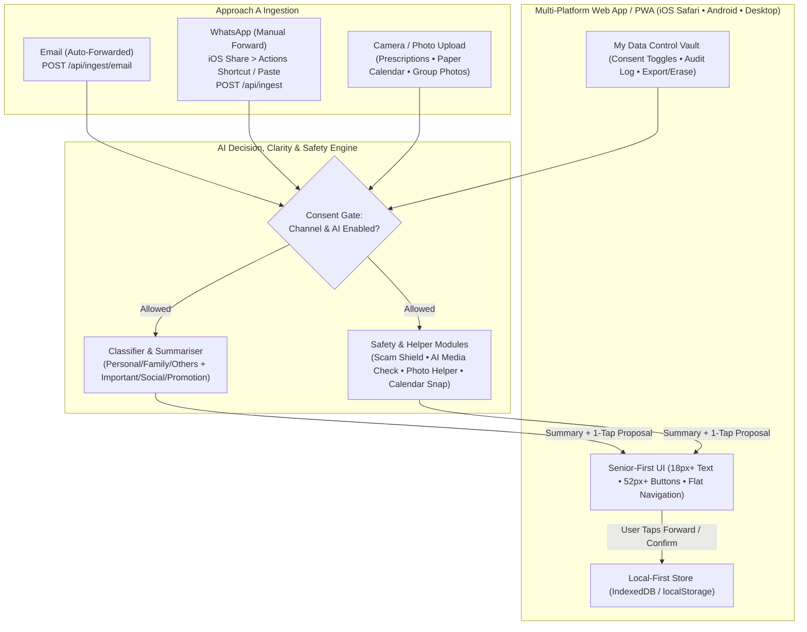

# Build_Bersama — Senior-Friendly Digital Companion Proposal

## 1. Background & Problem Statement

Senior citizens face growing digital overwhelm and safety risks across everyday tools (from `problem_statement.md`):
1. **Scams & Hacking:** Fear of clicking malicious links, phishing messages, and urgent impersonation scams.
2. **AI Photo Editing Confusion:** Wanting to fix blurry or old family photos without learning complex sliders or layers.
3. **Fragmented Communication Tools:** Prescriptions saved as photos, medical appointments buried in WhatsApp, and updates scattered across Email and social apps.
4. **AI-Generated Images & Voice Clones in Group Chats:** Difficulty recognizing fake or manipulated images and cloned voices forwarded in family/community group chats.
5. **Cluttered Paper Calendars:** Wanting to move from messy paper wall calendars to a calm, systematic phone calendar.

---

## 2. Core User Requirements & Design Principles

Guided by `proposal_approach.md` and senior accessibility best practices (Nielsen Norman Group / WCAG):
- **Web App / PWA (Multi-Platform & iOS-Friendly):** Works on **iOS Safari / iPhone Home Screen**, Android, and desktop browsers with zero app-store lock-in and zero risky unofficial WhatsApp scraping (**Approach A**).
- **User Always in Control of Their Data:** AI may read incoming data *only* with explicit per-source consent (`ON/OFF` toggles), shows a plain-language **"What AI Read"** log, and supports 1-tap **Export** or **Erase All Data**.
- **Bounded AI Decision Making:** AI organizes, summarizes, and warns automatically, but **never** sends replies, clicks links, or modifies calendars without an explicit **1-tap confirmation** from the senior.
- **Senior-First Simplicity:**
  - Large readable text (`18px+` body, `20px+` summaries) and high contrast.
  - Large tap targets (`52px+` buttons) with generous spacing.
  - **Icon + Plain Text Label + Color** everywhere (never rely on color alone).
  - Flat navigation (5 clear Home buttons + persistent **"Back to Home"**) and zero technical jargon.

---

## 3. Proposed App Functions (Section by Section)

### Section 1: Scam Shield ("Is This Safe?")
- **1-Tap Message / Link Checker:** Paste a suspicious text or upload a screenshot to receive a clear **Traffic-Light Verdict** (🟢 Looks Safe / 🟡 Be Careful — Verify First / 🔴 Likely Scam — Do Not Click or Pay) with plain-language reasons.
- **Golden Safety Habits:** Simple reminders on the 3 classic red flags (*Urgency*, *Secrecy*, *Unusual Payment*), the **Hang Up & Call Back on Saved Number** rule, and a **Family Secret Code Word**.
- **Guided Safe Phone Checklist:** Step-by-step toggles to lock down WhatsApp privacy (*Profile Photo to My Contacts*, *Silence Unknown Callers*) and screen lock.

### Section 2: One-Tap Photo Helper
- **Four Simple Presets (No Sliders):** **Make Clearer**, **Brighten Dark Photo**, **Fix Old / Scratched Photo**, and **Tidy Background**.
- **Safe Before / After View:** Always saves edits as a **new copy** so original family photos are never altered or lost.
- **Old Print Scan Tip:** 3-step guide for photographing printed album photos without lamp glare.

### Section 3: Unified Calm Inbox (Email + WhatsApp + Prescriptions)
- **How Messages Arrive (Approach A):**
  - **Email (Automatic Forwarding):** Gmail/Outlook auto-forwards messages into the Unified Inbox automatically (`POST /api/ingest/email`).
  - **WhatsApp (Manual Forward):** On iPhone, seniors use **`Message Select > Forward > Share > Actions ("Send to AI")`** via a 1-tap Apple Shortcut (`POST /api/ingest`), or paste/upload directly inside the web app.
- **Clear Source Attribution:** Every card displays an unmistakable **Source Badge** (e.g., `From Email` or `From WhatsApp`) with icon + label.
- **Two-Axis Smart Classification:**
  - **Who / Group Category:** `Personal` | `Family` | `Others`
  - **Priority / Type:** `Important` | `Social` | `Promotion`
- **AI Summarisation & Clarity:** Turns long emails, clinic notices, or messy forwards into a **1–2 sentence plain summary** (*Who sent it • From which app • What action is needed*).
- **1-Tap "Forward To..." Actions:**
  - **📅 Forward to Calendar** (extracts date, time, clinic/location -> 1-tap confirm)
  - **🛡️ Forward to Scam Check** (if an unknown sender uses urgency or suspicious links)
  - **🔍 Forward to AI Image Check** (if a group-chat photo looks suspicious)
  - **👨‍👩‍👧 Forward Summary to Family** (asks a trusted family member to double-check)

### Section 4: AI Image & Voice Checker (For Group Chats)
- **4-Spot Eye Check Guide:** Teaches seniors to inspect **Hands & Fingers**, **Background Words/Signs**, **Eyes, Teeth & Glasses**, and **Plastic/Smooth Face Edges**.
- **Media Verifier:** Scans uploaded group-chat images for AI markers (C2PA / generator tags) and communicates uncertainty honestly (since WhatsApp strips metadata, it never falsely claims *"100% Real"*).
- **Voice Clone Safety Rule:** Explains how short clips can mimic a relative's voice and directs seniors to verify via their **Family Secret Code Word** or saved phone number.

### Section 5: Systematic Phone Calendar (Paper-to-Phone)
- **Paper Calendar Snap:** Take a photo of a cluttered paper wall calendar -> AI extracts events one by one for quick `[✓ Keep]` / `[Skip]` confirmation.
- **4 Systematic Categories (Icon + Label + Color):** `Medical`, `Family & Social`, `Bills & Errands`, and `Daily Routine`.
- **Calm "Today & This Week" Default View:** Avoids cramped 30-day tiny-text grids; prevents duplicate entries when re-scanning paper calendars or forwarding appointments from the Unified Inbox.

### Cross-Cutting: My Data Control Vault
- **Per-Source ON/OFF Switches:** Turn Email auto-forwarding, WhatsApp intake, or AI reading on/off anytime.
- **Local-First Storage & Audit Log:** Plain-language **"What AI Read"** history, 1-tap **Download My Data**, and 1-tap **Erase Everything**.

---

## 4. Bounded AI Decision-Making Model

| Decision Tier | What AI Does Automatically | Example | User Control Safeguard |
| :--- | :--- | :--- | :--- |
| **Tier 1: Automatic Organization & Clarity** | Categorizes (`Personal` / `Family` / `Others`), prioritizes (`Important` / `Social` / `Promotion`), summarizes, and tags source. | Hides promotional ads; brings *"Eye Clinic Tue 10 AM"* to the top under **Personal • Important**. | User can view all buckets or turn off AI reading anytime. |
| **Tier 2: Proposed Action** | Prepares structured recommendations (`Forward to Calendar`, `Save New Photo Copy`). | *"Doctor visit on Tue 24 Nov, 10:00 AM — Forward to Calendar?"* | Nothing is saved or changed until the user taps **Confirm**. |
| **Tier 3: Escalate / Never Auto-Execute** | Warns clearly on high-risk scams or blurry prescription photos and offers **Ask Family to Check**. | Urgent bank link or blurry pill bottle label. | AI never sends replies, clicks external links, or deletes originals. |

---

## 5. High-Level Web App Architecture

